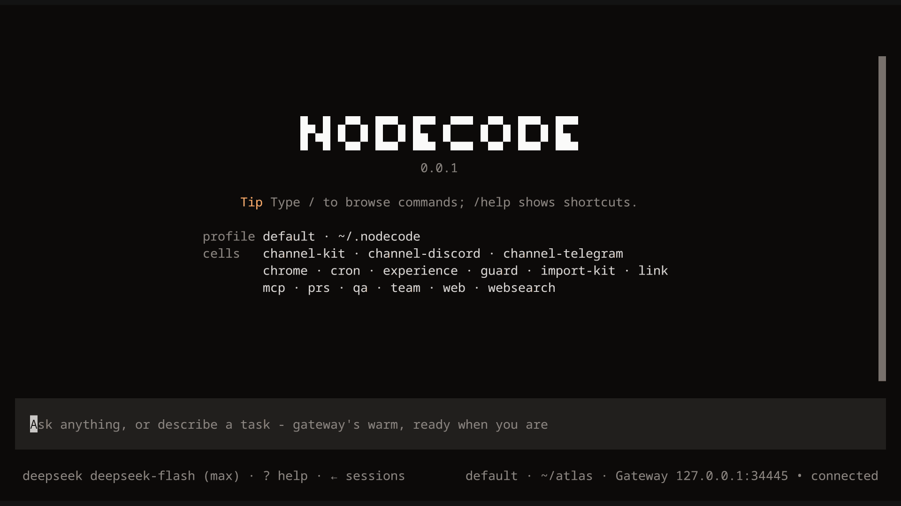
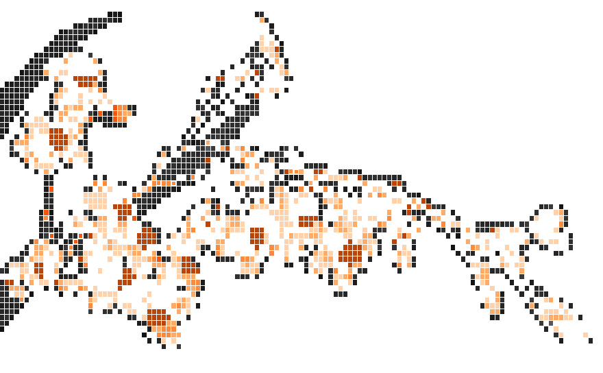
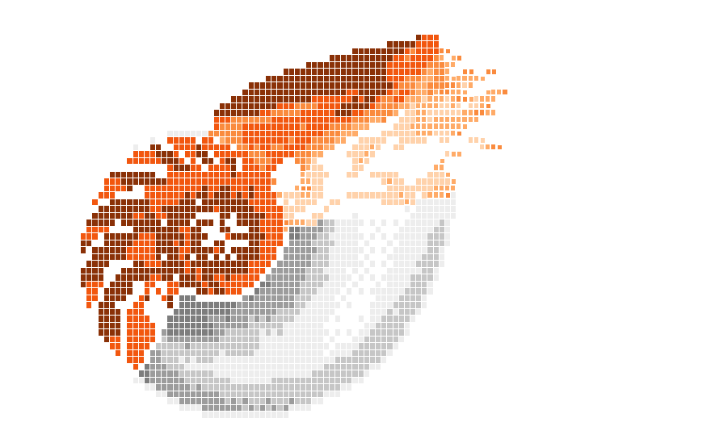
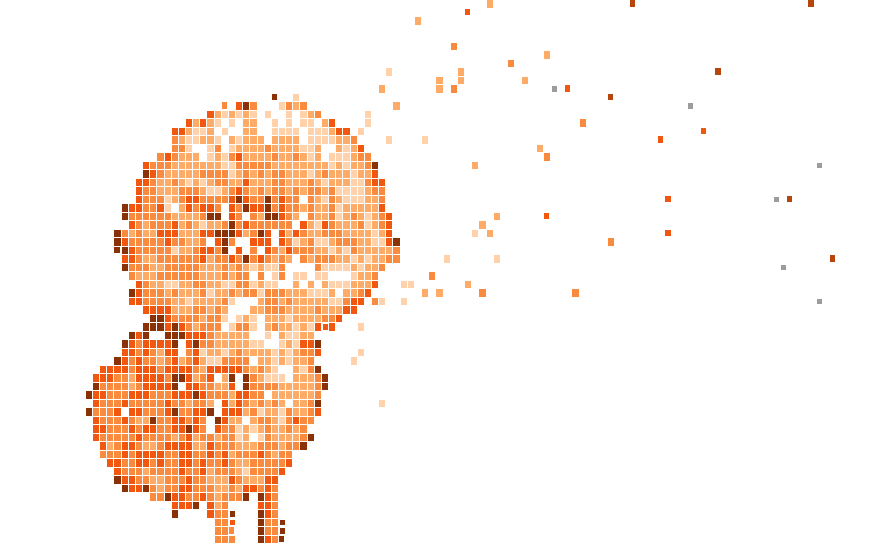

<p align="center">
  <a href="https://nodecode.ai"><picture>
    <source media="(prefers-color-scheme: light)" srcset="resources/assets/readme/banner-light.svg">
    
  </picture></a>
</p>

<p align="center">
  <b>A living agent.</b><br>
  It becomes yours and evolves over time.
</p>

<p align="center">
  <a href="https://nodecode.ai">Website</a> &nbsp;·&nbsp;
  <a href="https://nodecode.ai/docs">Docs</a> &nbsp;·&nbsp;
  <a href="https://nodecode.ai/cells">Cells</a> &nbsp;·&nbsp;
  <a href="https://foresight-labs.eu/research">Research</a>
</p>

<br>



<p align="center"><sub><i>you can't read PDFs. teach yourself.</i> It defines <code>read-pdf</code>, keeps it, and reads the invoice. A take from the launch trailer: the shell and every evaluation are real, the model's reply is scripted so the take repeats.</sub></p>

## Install

```sh
curl -fsSL https://nodecode.ai/install.sh | sh
```

Then run `nodecode`. Setup finds the homes of Claude Code, Codex, Hermes, OpenCode, Cursor, Gemini CLI and nine other agents on your machine, and offers to bring over their providers, keys, memory, skills, MCP servers and sessions.

On Windows, in PowerShell:

```powershell
irm https://nodecode.ai/install.ps1 | iex
```

## What's different

<picture>
  <source media="(max-width: 767px) and (prefers-color-scheme: light)" srcset="resources/assets/readme/emblem-mccarthy-light.png 2x">
  <source media="(max-width: 767px)" srcset="resources/assets/readme/emblem-mccarthy-dark.png 2x">
  <source media="(prefers-color-scheme: light)" srcset="resources/assets/readme/emblem-mccarthy-light.png 3.67x">
  <source srcset="resources/assets/readme/emblem-mccarthy-dark.png 3.67x">
  
</picture>

### It writes its own tools

There is one tool, `eval`. The model writes Lisp into the running program, and a definition is live the moment it's evaluated, in every shell attached: the terminal, `nodecode web`, your phone through `/link`, Discord, Telegram and `nodecode rpc`. Missing a tool? It writes one.

<br clear="left">

<picture>
  <source media="(max-width: 767px) and (prefers-color-scheme: light)" srcset="resources/assets/readme/emblem-orchid-light.png 2x">
  <source media="(max-width: 767px)" srcset="resources/assets/readme/emblem-orchid-dark.png 2x">
  <source media="(prefers-color-scheme: light)" srcset="resources/assets/readme/emblem-orchid-light.png 3.67x">
  <source srcset="resources/assets/readme/emblem-orchid-dark.png 3.67x">
  
</picture>

### It keeps what works

Definitions that prove themselves go into your layer, `~/.nodecode/cells/<you>/`, committed to git. Every good state is a generation: `nodecode generations` lists them, `nodecode rollback N` goes back, and `--pristine` boots the binary alone.

<br clear="left">

<picture>
  <source media="(max-width: 767px) and (prefers-color-scheme: light)" srcset="resources/assets/readme/emblem-nautilus-light.png 2x">
  <source media="(max-width: 767px)" srcset="resources/assets/readme/emblem-nautilus-dark.png 2x">
  <source media="(prefers-color-scheme: light)" srcset="resources/assets/readme/emblem-nautilus-light.png 3.67x">
  <source srcset="resources/assets/readme/emblem-nautilus-dark.png 3.67x">
  
</picture>

### It never compacts

When the context window fills, the oldest turns move to the log whole instead of being rewritten into a summary. `(recall-entry N)` reads any of them back word for word, and `/evict` makes room when you ask.

<br clear="left">

<picture>
  <source media="(max-width: 767px) and (prefers-color-scheme: light)" srcset="resources/assets/readme/emblem-dandelion-light.png 2x">
  <source media="(max-width: 767px)" srcset="resources/assets/readme/emblem-dandelion-dark.png 2x">
  <source media="(prefers-color-scheme: light)" srcset="resources/assets/readme/emblem-dandelion-light.png 3.67x">
  <source srcset="resources/assets/readme/emblem-dandelion-dark.png 3.67x">
  
</picture>

### Everything is a cell

Chat rooms, provider logins, tools, skills, MCP servers: each is a folder of Lisp. `nodecode add nc://cline` installs one from the hub. Or ask Nodecode to write one.

<br clear="left">

## Fewer tokens, same score

<picture>
  <source media="(prefers-color-scheme: light)" srcset="resources/assets/readme/bars-light.svg">
  
</picture>

On the same model, Nodecode finished every public ARC-AGI-3 game with **54% fewer tokens than Claude Code**, and used 21% fewer than Codex on the games both finished. The write-up is coming on [Foresight Labs](https://foresight-labs.eu/research).

<details>
<summary><b>How the runs were measured</b></summary>
<br>

The 25 public ARC-AGI-3 games, each scored with the official scorecard rule. A token is every token put through the model: input, cache reads and writes, and output. Both pairs ran at xhigh effort. On Claude Opus 5.5, Nodecode and Claude Code each scored 100 on all 25 games. On GPT-6.1 Sol, Codex finished 20 games, and the pair is compared on those. Hermes finished 3 games on Opus 5.5, too few for a bar; on those 3 Nodecode used 36% fewer tokens. These are first cuts, and the numbers match the chart on [nodecode.ai](https://nodecode.ai).

</details>

## Cells

A cell is a folder of Lisp with its own `.asd` that grows the organism. These ship with it, and setup asks which to turn on:

| Cell | What it does |
| --- | --- |
| `discord` · `telegram` | Talk to Nodecode through a bot: threads, attachments, durable transcripts |
| `web` · `link` | Use it in a browser tab with `nodecode web`; reach that page from anywhere with `/link on` |
| `chrome` | Drive Chrome, with the companion extension |
| `websearch` | Web search and page fetch, no key needed |
| `mcp` | Tools from the MCP servers you list |
| `cron` | Prompts that run on a schedule |
| `team` | Several sessions work one task together in a shared folder |
| `prs` | Pull requests ranked and reviewed minutes after each push |
| `experience` | Learns from each turn: reflections and recaps |
| `guard` | Refuses risky shell commands before they run |
| `import` | Brings another coding agent's home into this one |

More are on the hub at [nodecode.ai/cells](https://nodecode.ai/cells). To write your own, ask Nodecode, or start from the contract in [src/CELLS.md](src/CELLS.md).

## More

<details>
<summary><b>Bring any model</b></summary>
<br>

Four wire dialects (Anthropic Messages, OpenAI Responses, OpenAI Chat Completions and Google) cover the hosted providers and any OpenAI-compatible server, local ones included. The [models.dev](https://models.dev) catalog supplies context windows and prices, `/think` sets the effort, and setup keeps keys in `~/.nodecode/auth.json` (mode 0600). See [Models](https://nodecode.ai/docs/models).

</details>

<details>
<summary><b>Do I need to know Lisp?</b></summary>
<br>

No. You ask in plain words, the model writes the Lisp, and your project can be in any language. The forms it runs show on screen, and they are short.

</details>

<details>
<summary><b>Is it safe to run?</b></summary>
<br>

Nodecode has no sandbox. It runs as your user, with your permissions. The `guard` cell refuses known risky commands, but it only slows mistakes down; it can't stop them. For untrusted work or unattended bots, run it in a container or a VM. The details are in [Security](https://nodecode.ai/docs/security).

</details>

<details>
<summary><b>Does it phone home?</b></summary>
<br>

There's no account, and no telemetry unless you turn it on. It talks to the provider you configure, checks the release feed for updates (`update.mode`: `auto`, `ask` or `off`), and fetches the models.dev catalog. The `qa` cell sends anonymous usage counts once a week, and only if you say so.

</details>

<details>
<summary><b>Which platforms?</b></summary>
<br>

Linux x86_64 with glibc 2.38 or newer (Ubuntu 24.04+, Debian 13+, Fedora 39+, Arch), Apple Silicon on macOS 15+, and Windows x86_64 with Git for Windows. There are no arm64 Linux or Intel Mac builds yet. See [Install](https://nodecode.ai/docs/install).

</details>

<details>
<summary><b>Build from source</b></summary>
<br>

You need SBCL (we build on 2.6.8), [Quicklisp](https://www.quicklisp.org/beta/), python3, `just` and git.

```sh
git clone https://github.com/nodecode-ai/nodecode && cd nodecode
just release     # pulls the shipped cells, dumps ./nodecode
./nodecode
```

Want to work on Nodecode itself? Start with [src/README.md](src/README.md), which explains how it's put together.

</details>

<br>

<sub>MIT; see [LICENSE](LICENSE). [NOTICE](NOTICE) carries the attribution for cl-tuition, which the terminal core builds on. The emblems are drawn in cells from other people's footage: the nautilus from video S2 of Barord et al., PLOS ONE 9(6): e100799, 2014, under CC BY 4.0, and John McCarthy from The Computer Chronicles, 1984, © Stewart Cheifet Productions. Every source is listed on [nodecode.ai/credits](https://nodecode.ai/credits).</sub>
